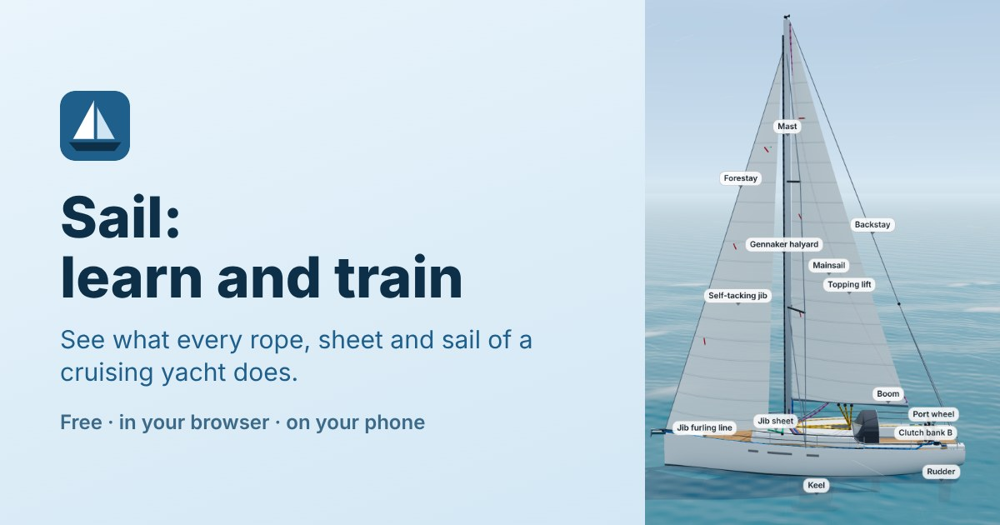
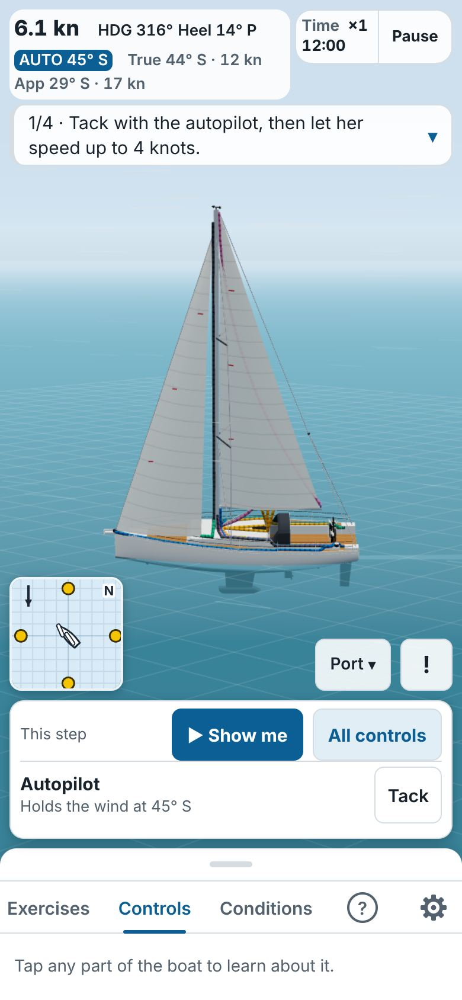
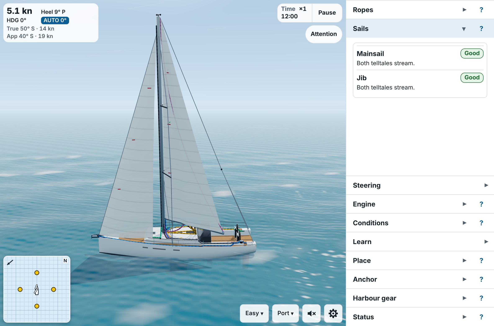
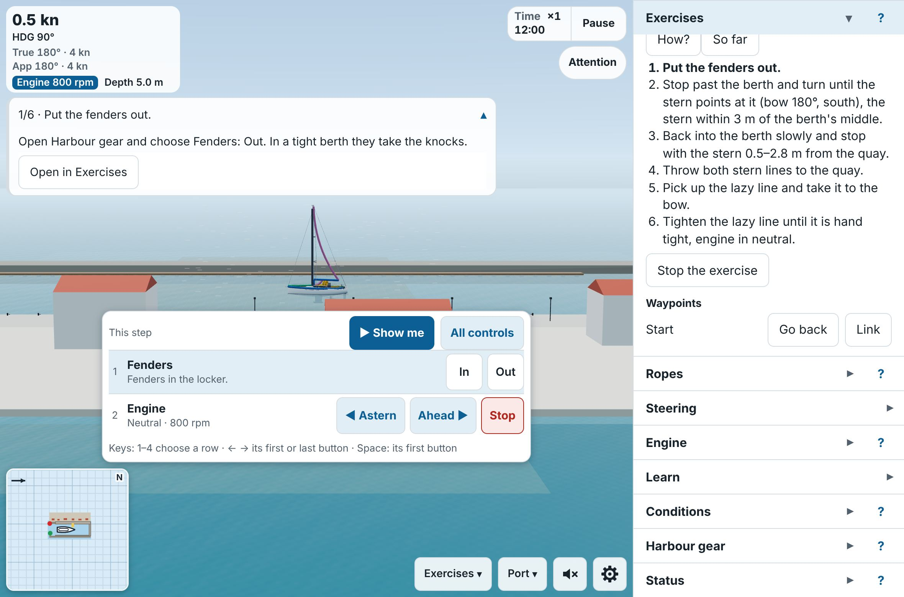
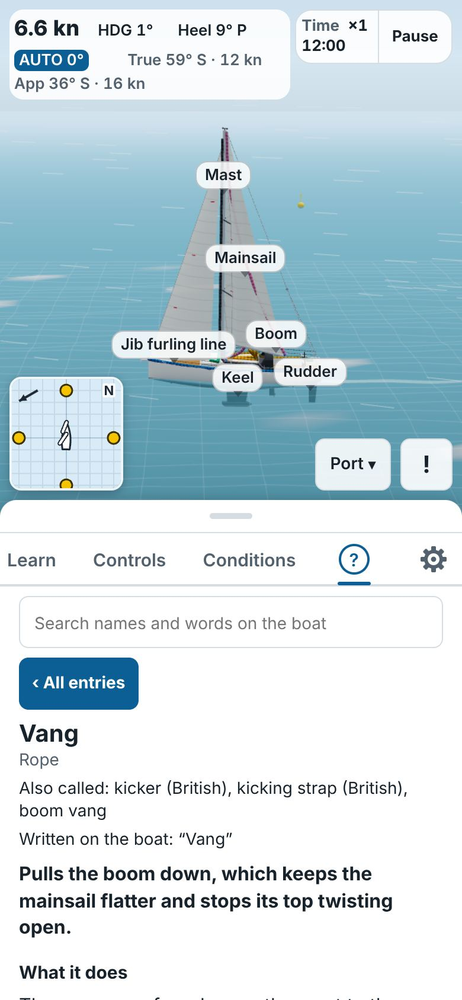
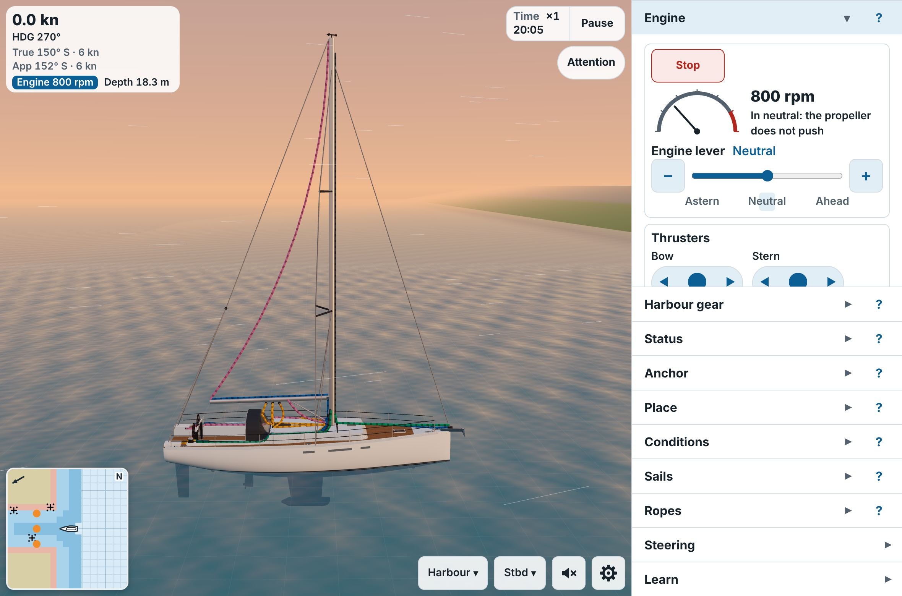

# Sail: learn and train

A free web app that shows a complete beginner what every rope, sheet and sail of a cruising yacht does, and lets you practise on a 3D model of a **Hanse 508**. It runs in the browser, nothing to install.

### ▶ [Try it in your browser](https://botrops1.github.io/sail-learn-and-train/)

**Who it is for:** someone who has never sailed (or is about to crew on a yacht) and wants to understand the boat before stepping on it. **How it works:** you set a wind, work the ropes, and see at once what the boat and the sails do. Clarity over realism: it teaches how things behave, it is not a simulator for racing.

On your first visit a short **welcome card** offers to start the first exercise for you, or to look around the boat. Settings → About shows it again.

| On a phone: an exercise | On a computer: sailing | Harbour: entering a berth |
|---|---|---|
|  |  |  |

| Learn: every part and rope | Evening in the bay |
|---|---|
|  |  |

> **Honest limits today.**
> - **Phone or computer:** the exercises and the Learn list work on a phone; the full experience (Realistic rope work, the map and the panels side by side) wants a computer.
> - **Simple surroundings:** sea, sky, a marina and a bay, drawn plainly. Enough for the exercises, not a game.
> - **Clarity over realism:** the physics is simplified on purpose.
> - **English only for now:** the **Russian text is an AI draft** that no sailor has checked yet.

## What you can do

**Look and learn**
- Look at the boat in 3D: drag to turn, pinch to zoom, or pick a view with the **camera chip** (port side, starboard side, top, bow, helm, map, free). Tap any part or rope to see its name, the label written on the boat and what it does.
- Open the **Learn** tab: every part, rope and sailing word has an entry (what it is called, what it does, how it works on this boat, typical mistakes and fixes, how sure the app is, with sources). **Show it working** and **Where is it?** fly the camera to the part. A search finds names, other names and the words printed on the boat.

**Work the ropes**
- Set a test wind (direction on a dial, speed in knots, presets) and move the ropes. **Easy mode**: every rope is a slider. **Realistic mode**: you stand at one place on the boat (port, starboard, helm, mast), open and close the clutches (the levers that hold a rope), wrap ropes on the electric winches (the drums that pull them in), and use the winch handle. Ropes slip or run out when they are not held, and the loads on them come from the real sail forces.
- The idea to keep: *ropes limit, wind pushes*. Easing a sheet (a rope that sets a sail's angle) only lets the wind push the sail further.

**Sail**
- Switch from *Held still* to *Sailing*: the wind pushes the boat, the wheel turns her only while she moves, and the **autopilot** holds a heading or a wind angle and tacks or gybes on a button.
- See what your trim does: sails flap (luff) or work well or stall, with telltales (short ribbons), the boat heels and gets weather helm (pulls toward the wind), and can round up. A gybe (the stern passing through the wind) shows the boom's speed and the load on the main sheet.
- Wind modes (steady, gusty, shifty, building, dying), waves sized by the wind, a clock and sun for Croatia (Split) with sunset, night and stars, and a time bar (slow motion, pause, up to ×16).
- A bird's-eye **map** (and a mini-map in a corner) with the boat, her track, both winds and the no-go zone.

**Harbour and anchor**
- **Harbour mode**: engine lever (one lever, astern to ahead), bow and stern **thrusters**, fenders, mooring lines and the windlass (the anchor winch). Move the boat to open water, a made-up Mediterranean **marina** (tight, medium or spacious berths, busy or empty) or a **bay** with a depth map, rocks, shore rings and mooring buoys.
- Slowly, the wind pushes her sideways and the propeller walks the stern; touching a quay, a yacht or the bottom gives a **damage report**. Go stern-to in the marina, take a bow line to a buoy, or **anchor** (chain out and in, scope, an alarm if the anchor drags, a line ashore). A night at anchor runs twelve hours in a few minutes, and the wind follows the clock: the Adriatic's maestral, bura and jugo.

**Helm panels and the status**
- A control panel at each wheel (engine lever and tachometer, thruster joysticks, compass, wind data, autopilot keypad) with live values, and a **Helm camera** at either wheel looking ahead, at the panel or at the ropes.
- A **Status** section: the sails, the gear, any damage and a tagged history of what happened.

**Exercises**
- **Exercises mode** gives guided tasks with a coach: a card with what you see, what is happening, the right action and the typical mistake; steps that tick themselves off; mistakes that can pause time and explain themselves; waypoints to go back to; and a **debrief** at the end.
- Exercises work on a normal phone. A **step bar** over the 3D view holds the controls the current step needs. **Watch it** lets the app sail the exercise for you and stops after each step; **Show me** plays one step, then it is your turn.
- Seventeen exercises today. **Sailing:** trim through the points of sail, tacking, getting out of irons (head to wind and stuck), gybing (controlled and accidental), gusts, too much wind (reduce sail), setting and furling the sails (alone or with crew). **Harbour and anchor:** leaving the berth, entering the berth stern-to, turning in her own length, picking up a mooring buoy, anchoring with a line ashore, going stern-to on your own anchor, and a night at anchor. **Wind and weather:** the afternoon maestral (the Adriatic's summer sea breeze) and a bura coming (its strong, gusty north-east wind).
- The full list, with what each one teaches: [`docs/EXERCISES.md`](docs/EXERCISES.md).

**Sound**
- Wind, waves, flapping and full sails, the engine, winches, the anchor chain, the marina and birds, and quiet music, all generated by the app (no sound files). Off until you switch it on (Settings → Sound).

**Languages, sharing and your own setup**
- The whole app in **English or Russian** (Settings). More languages can be added as data: [`docs/LANGUAGES.md`](docs/LANGUAGES.md).
- **The link is the state.** The address holds the wind, the boat, the ropes, the place, the time and the exercise step. **Share** (Settings → Share) copies a link that reproduces exactly what you see: send it with a question or a bug report, and the other person sees the same thing. Your whole **setup can be saved to a file** and loaded again.
- **Boat profiles**: download the boat's numbers as a file, edit them for a similar yacht and import it. See [`docs/BOAT_PROFILE.md`](docs/BOAT_PROFILE.md).

**The screen.** On a phone the controls sit in a **sheet** pulled up from the bottom (with tabs for mode, controls, conditions, Learn and settings); on a computer they sit in columns on the right (two columns on a wide screen), with **Mode** and **Settings** chips. Three modes decide what comes first (**Learn**, **Easy**, **Realistic**), and there are **Harbour** and **Exercises**. A mode never changes the boat; every section can be reached from every mode.

## Where the project stands

Done: the boat and its controls, the moving boat, waves and sky, the Learn layer in English and Russian, the layout and modes, boat details, harbour and anchor, panels, status, setup files and boat profiles, the visual work, sound, all three parts of the exercises (sailing; harbour and anchor; wind and weather), exercises on a normal phone, easier camera control, releases and a welcome for new visitors.

Next: a sailor's review of the Russian text and more languages, a fuller physics model with people on board ([study](docs/PHYSICS_ENGINE_ANALYSIS.md)), the computer controls outside exercises ([#161](https://github.com/Botrops1/sail-learn-and-train/issues/161)), and whatever sailors who try it ask for most. Phases and decisions: [`docs/ROADMAP.md`](docs/ROADMAP.md). Public launch checklist: [issue #165](https://github.com/Botrops1/sail-learn-and-train/issues/165).

Open limits: the frame rate on phones is still to be checked on real devices; a browser without WebGL shows the panel but not the 3D boat.

## How to help

The project is looking for people. You do not need to write code for most of it:

- **Find mistakes:** a rope that does the wrong thing, a wrong name or number. Settings → Share gives a link to exactly what you see.
- **Suggest an exercise:** what the learner sees, what is happening, the right action and the typical mistake.
- **Translate:** a language is one folder of text files.
- **Add a boat or a sailing area:** a similar yacht is a file of numbers; a different rig or a new harbour also needs code.
- **Build features** or tell us how it runs on your phone.

How: [`CONTRIBUTING.md`](CONTRIBUTING.md); questions go to [Discussions](https://github.com/Botrops1/sail-learn-and-train/discussions). Please follow the [Code of Conduct](CODE_OF_CONDUCT.md), and report security problems privately ([`SECURITY.md`](SECURITY.md)).

## Privacy

The app sends nothing about you. Visits to the live site are counted anonymously with [GoatCounter](https://www.goatcounter.com): no cookies and no personal data ([how GoatCounter handles this](https://www.goatcounter.com/help/gdpr)). Test versions (`/next/` and PR previews) count nothing.

What you set (layout, imported boats, exercise ticks, whether you have seen the welcome) stays in your browser on this device. The site is hosted on GitHub Pages ([GitHub's privacy statement](https://docs.github.com/en/site-policy/privacy-policies/github-general-privacy-statement)).

## Disclaimer

A learning aid for understanding, **not** a substitute for sailing instruction or the skipper's briefing. Geometry and behaviour are simplified. Terms marked "draft" have not been reviewed by a sailor yet.

Hanse and Hanse 508 are names of their owner; this project is not affiliated with Hanse Yachts. No manufacturer material is included; boat figures are cited from the public specification.

## License

GPL-3.0-only. See [`LICENSE`](LICENSE).

The photos in [`docs/reference/photos/`](docs/reference/photos) are the project owner's own, licensed under [CC BY-SA 4.0](https://creativecommons.org/licenses/by-sa/4.0/).

---

# For developers

Developed with Claude Code in the cloud and reviewed from a phone. The live site (the address above) changes only when a release is published; the latest work is at `https://botrops1.github.io/sail-learn-and-train/next/` for testing. Stack: Vite, TypeScript, three.js, Vitest; deployed with GitHub Actions to GitHub Pages. There are no 3D model, picture or sound files for the scene: the boat, rig, ropes, marina, bay and sounds are all built by code from the numbers in [`content/`](content), so every change can be read and reviewed as text. See [`CONTRIBUTING.md`](CONTRIBUTING.md) for how to work on it and [`docs/CODE_MAP.md`](docs/CODE_MAP.md) for which file does what.

## Commands

| Command | Purpose |
|---|---|
| `npm run dev` | Local dev server |
| `npm run build` | Production build into `dist/` |
| `npm test` | Unit and data tests (Vitest) |
| `npm run typecheck` | TypeScript check |
| `npm run lint` | ESLint and Prettier check |
| `npm run shots` | Build, then browser checks and screenshots into `shots/` (not committed; options at the top of `scripts/shots.mjs`) |
| `node scripts/visual-shots.mjs` | After a build: camera presets and close-ups at both detail levels, plus draw calls, triangles and FPS |

Add `?debug=1` to the address to see the frame rate, the slowest frame and the work per frame (for performance reports).

## Link settings

The address reproduces the state. The main keys (all of them are read in [`src/app/urlState.ts`](src/app/urlState.ts)):

| Key | Meaning |
|---|---|
| `lang` | `ru` shows the app in Russian |
| `m`, `mode` | the mode (`m=learn` opens Learn mode; the ropes mode stays `mode`) |
| `sea` | waves: `flat`, `sheltered`, `coastal`, `open` |
| `clk`, `clock` | time on board (local `YYYYMMDDHHMM`); `clock=0` hides the clock chip |
| `learn` | opens that Learn entry, e.g. `learn=rope_vang` |
| `mm` | `0` hides the mini-map |
| `fd` | `1` puts the fenders out |
| `ex`, `exw`, `exp` | an exercise by id, its start state and the coach (`exp=0` hides it) |
| `debug` | `1` shows the frame-rate overlay |

Old links keep opening the same picture.

## Documents

| File | What it is |
|---|---|
| [`docs/ROADMAP.md`](docs/ROADMAP.md) | All phases, architecture principles, decisions log |
| [`docs/PHASE1_SPEC.md`](docs/PHASE1_SPEC.md) | Phase 1: the boat and its controls |
| [`docs/PHASE2_SPEC.md`](docs/PHASE2_SPEC.md) | Phase 2: the moving boat |
| [`docs/PHASE3_SPEC.md`](docs/PHASE3_SPEC.md) | Phase 3: waves, wind on the water, clock and sky |
| [`docs/PHASE4_SPEC.md`](docs/PHASE4_SPEC.md) | Phase 4: the Learn entries, glossary and search, the Russian app |
| [`docs/PHASE5_SPEC.md`](docs/PHASE5_SPEC.md) | Phase 5: settings menu, camera chip, phone sheet, modes, mini-map, wide layout |
| [`docs/PHASE6_SPEC.md`](docs/PHASE6_SPEC.md) | Phase 6: boat details (anchor, cleats, fairleads, fenders) |
| [`docs/PHASE7_SPEC.md`](docs/PHASE7_SPEC.md) | Phase 7: marina, bay and anchor |
| [`docs/PHASE8_SPEC.md`](docs/PHASE8_SPEC.md) | Phase 8: phone tabs, Status, setup file, boat profiles |
| [`docs/PHASE9_SPEC.md`](docs/PHASE9_SPEC.md) | Phase 9: visual quality, helm panels, Helm camera |
| [`docs/PHASE10_SPEC.md`](docs/PHASE10_SPEC.md) | Phase 10: Exercises mode, the coach and the exercises (10a sailing, 10b harbour and anchor, 10c wind and weather) |
| [`docs/PHASE10_PHONE_SPEC.md`](docs/PHASE10_PHONE_SPEC.md) | Exercises on a phone (M79–M82) |
| [`docs/PHASE_LAUNCH_SPEC.md`](docs/PHASE_LAUNCH_SPEC.md) | Launch: faster CI, releases, the welcome, the launch texts (M83–M86) |
| [`docs/PHASE_AUDIO_SPEC.md`](docs/PHASE_AUDIO_SPEC.md) | Sound (M87–M91) |
| [`docs/PHASE_TIME_SPEC.md`](docs/PHASE_TIME_SPEC.md) | The time widget (M92) |
| [`docs/PHASE_STEP_CARD_SPEC.md`](docs/PHASE_STEP_CARD_SPEC.md) | One step card over the 3D view (M93) |
| [`docs/PHASE_CAMERA_SPEC.md`](docs/PHASE_CAMERA_SPEC.md) | Easier camera control (M99) |
| [`docs/PHYSICS_ENGINE_ANALYSIS.md`](docs/PHYSICS_ENGINE_ANALYSIS.md) | The study for a fuller physics model and people on board |
| [`docs/MAINTAINING.md`](docs/MAINTAINING.md) | For the owner: how to handle issues and pull requests from other people |
| [`docs/screenshots/`](docs/screenshots) | The README's pictures and how to retake them |
| [`docs/BETA.md`](docs/BETA.md) | A one-page guide for the sailors of the quiet beta |
| [`docs/ANNOUNCE.md`](docs/ANNOUNCE.md) | Drafts of the announcement texts |
| [`docs/EXERCISES.md`](docs/EXERCISES.md) | The exercise catalogue, failure modes and wind modes |
| [`docs/LAYOUT_ANALYSIS.md`](docs/LAYOUT_ANALYSIS.md), [`docs/BOAT_DETAILS_ANALYSIS.md`](docs/BOAT_DETAILS_ANALYSIS.md), [`docs/VISUAL_QUALITY_ANALYSIS.md`](docs/VISUAL_QUALITY_ANALYSIS.md) | Records of the analyses behind Phases 5, 6 and 9 |
| [`docs/LANGUAGES.md`](docs/LANGUAGES.md) | How to add a language (one folder of JSON files) |
| [`docs/BOAT_PROFILE.md`](docs/BOAT_PROFILE.md) | How to make a boat profile |
| [`docs/BOAT_REFERENCE.md`](docs/BOAT_REFERENCE.md) | Facts about the boat, sources, assumptions, open questions |
| [`docs/PHYSICS_TRUTHS.md`](docs/PHYSICS_TRUTHS.md) | Sailing rules the simulation must obey, with sources and tests |
| [`docs/WORKFLOW.md`](docs/WORKFLOW.md) | How to build and check each milestone from a phone |
| [`docs/CODE_MAP.md`](docs/CODE_MAP.md) | Which file does what |
| [`docs/review/ru.md`](docs/review/ru.md), [`docs/review/ru-exercises.md`](docs/review/ru-exercises.md) | What a Russian-speaking sailor reviews |
| [`CLAUDE.md`](CLAUDE.md) | Instructions for the coding agent |
| [`content/`](content) | Boat geometry, term registry, exercises and texts (data, not code) |
